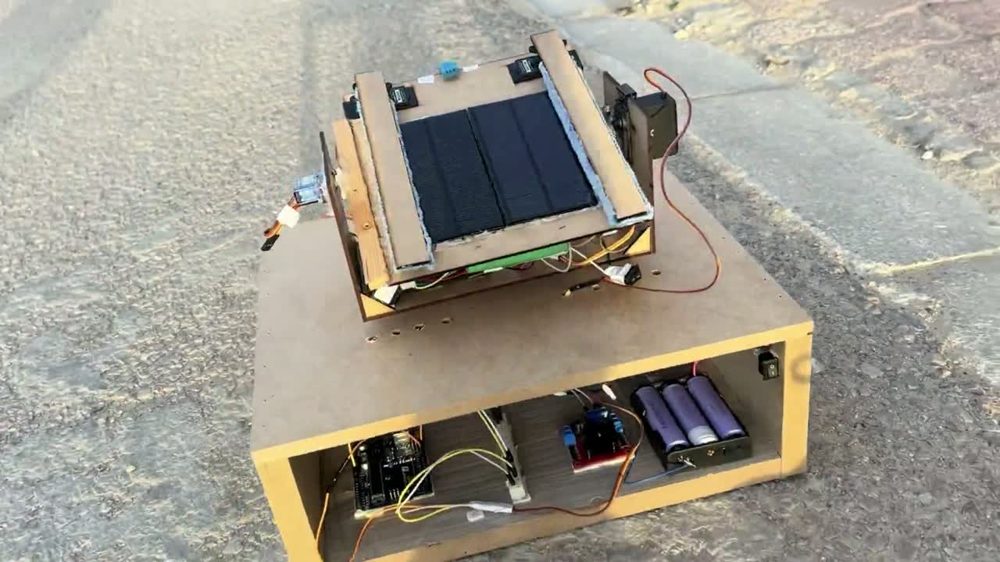
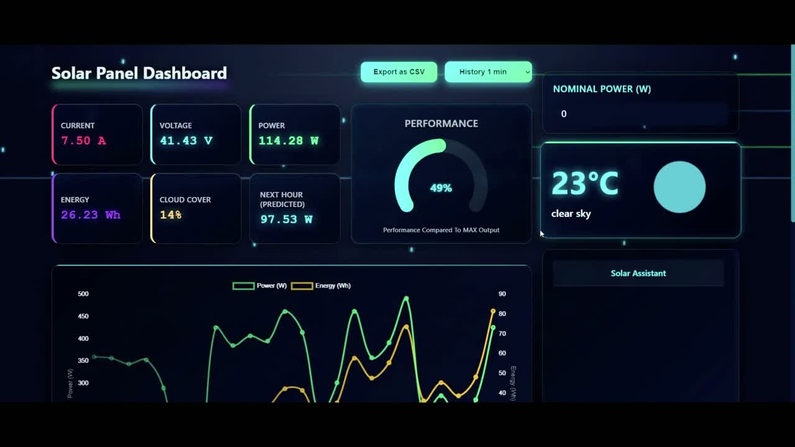
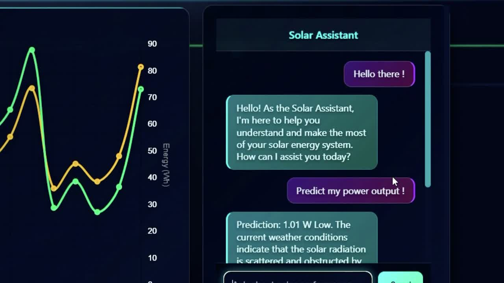

# AI Solar Panel Monitoring System

An end to end smart solar system that **measures** a solar panel in real time, **predicts** its production with machine learning and live weather, **detects** when the panel underperforms (dirt, shading, wiring problems), **cleans** it with a servo driven mechanism, and lets the operator **talk** to an AI solar assistant from a modern web dashboard.

Built for the **CASS TSYP13 Challenge**.

## Demo

[](demo/demo.mp4)

**[Watch the demo video (34 seconds)](demo/demo.mp4)**

| Dashboard | AI Solar Assistant |
|:---:|:---:|
|  |  |

## Table of contents

1. [Features](#features)
2. [Architecture](#architecture)
3. [Hardware](#hardware)
4. [Machine learning model](#machine-learning-model)
5. [Smart alerts](#smart-alerts)
6. [Firebase data model](#firebase-data-model)
7. [API](#api)
8. [Technologies](#technologies)
9. [Project structure](#project-structure)
10. [Quick start](#quick-start)

For a full step by step guide, read [TUTORIAL.md](TUTORIAL.md).

## Features

| Area | What it does |
|---|---|
| Live monitoring | Voltage, current, power, energy, temperature and humidity of the panel, sent by an ESP32 to Firebase |
| Weather | Current temperature, sky condition and cloud cover from OpenWeatherMap at the panel location |
| Production forecast | Random Forest model that predicts the solar output of the next hour from the weather |
| Performance | Gauge comparing the real output with the panel maximum output |
| History | Charts of real power and energy, real versus predicted energy, CSV export |
| Smart alerts | Automatic alerts when the real output does not match the prediction, with advice on what to check |
| AI assistant | Chat that answers questions about solar energy and explains the prediction, powered by a local LLM (Ollama) |
| Cleaning | Two servo motors move a cleaning brush across the panel |
| Accounts | Sign up, login with email and password or with Google (Firebase Authentication) |

## Architecture

| Layer | Component | Role |
|---|---|---|
| Hardware | ESP32 with INA219 and DHT11 | Measures the panel and sends data every loop |
| Hardware | Servo cleaning mechanism | Cleans the panel surface |
| Cloud | Firebase Realtime Database | Stores live sensors, history, predictions and alerts |
| Backend | FastAPI (`main.py`) | Prediction endpoint and AI chat endpoint |
| Backend | Scheduler (`scheduler.py`) | Every 15 minutes: measures energy, every hour: saves history, predicts the next hour and raises alerts |
| AI | scikit-learn Random Forest | Solar production prediction |
| AI | Ollama (llama2) | Natural language answers and explanations |
| Frontend | React and Vite dashboard | Visualisation, alerts and chat |

## Hardware

**Sensor and cleaning board (`arduino/netoyagecapteur`), ESP32**

| Component | Pin | Role |
|---|:---:|---|
| INA219 current sensor | I2C (SDA 21, SCL 22) | Bus voltage, current and power of the panel |
| DHT11 | 4 | Temperature and humidity |
| Servo 1 | 15 | Cleaning brush movement |
| Servo 2 | 2 | Cleaning brush movement |
| Boot button | 0 | Starts a cleaning cycle |

**Rotation test board (`arduino/coderotation`), Arduino**

Drives two continuous rotation servos (pins 9 and 10) through a calibrated sequence of angles. It is used to tune the movement of the cleaning mechanism.

## Machine learning model

| Item | Value |
|---|---|
| Model | `RandomForestRegressor` (scikit-learn) |
| File | `backend/models/modele_production_solaire.pkl` |
| Target | Estimated solar production |
| Inputs | Temperature, humidity, solar irradiance, cloud cover, wind speed, elevation, smoothed irradiance and production, corrected efficiency, year, month, day, hour, day of week, temperature times irradiance, previous production |
| Configuration | `backend/config/config_model.json` (feature order and min, max and mean of every feature) |

At prediction time the backend reads the panel location from Firebase, calls OpenWeatherMap, builds the feature vector (missing values are replaced by the training mean and every value is clipped to its training range) and runs the model.

## Smart alerts

The scheduler compares the real energy of the last hour with the prediction:

| Alert | Condition | Advice |
|---|---|---|
| High Prediction With Zero Output | Real output is zero while a high output is expected | Check wiring or inverter |
| Energy Prediction Too High | Prediction is more than 50 percent above the real output | Reduce load or check sensors |
| Energy Prediction Too Low | Prediction is more than 40 percent below the recent average | Inspect panels for dirt or shading |

## Firebase data model

| Path | Written by | Content |
|---|---|---|
| `/sensors` | ESP32 | `voltage`, `current`, `power`, `temperature`, `humidity` |
| `/location` | Operator | `lat` and `lon` of the panel |
| `/realHistory` | Scheduler | Power, energy and time of each hour |
| `/history/real` | Scheduler | Last real hourly energies |
| `/history/predicted` | Scheduler | Predicted energy of the next hour |
| `/alerts` | Scheduler | Title, content and time of each alert |

## API

The FastAPI server runs on port 8000. Interactive documentation: `http://127.0.0.1:8000/docs`.

| Method | Route | Description |
|---|---|---|
| GET | `/prediction` | Prediction, the features used, raw weather and location |
| POST | `/chat` | Body `{"message": "..."}`. Answers solar questions, or returns a prediction with a short explanation when the user asks for a forecast |

## Technologies

| Part | Tools |
|---|---|
| Firmware | Arduino C++, ESP32, Firebase ESP32 Client, Adafruit INA219, DHT, ESP32Servo |
| Backend | Python, FastAPI, Uvicorn, pandas, scikit-learn, joblib, requests |
| AI | Random Forest regression, Ollama with llama2 |
| Data | Firebase Realtime Database, OpenWeatherMap API |
| Frontend | React 19, Vite, React Router, Chart.js, ApexCharts, Recharts, Axios, Sass |
| Auth | Firebase Authentication (email and Google) |

## Project structure

```
AI_Solar_Panel_Monitoring_System/
|__ arduino/
|   |__ netoyagecapteur/        ESP32: sensors, Firebase upload, cleaning servos
|   |__ coderotation/           Arduino: servo rotation calibration
|__ backend/
|   |  main.py                  FastAPI server (prediction and AI chat)
|   |  prediction.py            Weather fetch, feature building, model inference
|   |  scheduler.py             Energy measurement, history, predictions, alerts
|   |  firebase.py              Firebase REST helpers
|   |  buffer.py                Local buffer of interval energies
|   |__ config/                 Model feature configuration
|   |__ models/                 Trained Random Forest model
|__ frontend/                   React dashboard
|   |__ src/components/         Dashboard, charts, gauges, login, signup
|__ demo/                       Demo video and screenshots
```

## Quick start

```bash
git clone https://github.com/achrefslim/AI_Solar_Panel_Monitoring_System.git
cd AI_Solar_Panel_Monitoring_System
```

Backend:

```bash
cd backend
pip install -r requirements.txt
uvicorn main:app --reload
python scheduler.py
```

AI assistant (in another terminal):

```bash
ollama pull llama2
ollama serve
```

Frontend:

```bash
cd frontend
npm install
npm run dev
```

Before starting, copy `backend/.env.example` to `backend/.env` and `frontend/.env.example` to `frontend/.env` and fill in your Firebase and OpenWeatherMap values. See [TUTORIAL.md](TUTORIAL.md) for every detail.

## Security

No credential is stored in the repository. All keys are read from `.env` files that are ignored by git, and the ESP32 sketch only contains placeholders.

## Author

[achrefslim](https://github.com/achrefslim)
